<p align="center">
  <a href="https://jestivald.tech">
    
  </a>
</p>

### ❯ whoami

Student and systems tinkerer. I take bare Linux boxes and make them fast, hardened
and observable — kernel tuning, nftables, containers, tunnels — then turn the scars
into scripts and runbooks. Off the servers I study electronics design: PCBs, STM32,
circuit simulation. Most of it is pair-built with **Claude Code**, hence
*“doctore claude”* — I set the task, verify the result and answer for it myself.

- 🌐 [**jestivald.tech**](https://jestivald.tech) — terminal-flavored homepage
- 💬 [**@jestivald**](https://t.me/jestivald) — Telegram

### ❯ ls ~/projects

| repo | what it does |
|------|--------------|
| [**node-accelerator**](https://github.com/jestivald/node-accelerator) ⭐ | Bash toolkit that tunes and shields a Linux server — XanMod + BBRv3, sysctl, nftables anti-flood, CrowdSec, `na-report` forensics. Latest release: **v4.2** |
| [**server-bench**](https://github.com/jestivald/server-bench) | All-in-one server diagnostics & benchmark — CPU/disk/net, scorecard verdicts, `--json` output |

### ❯ ls ~/work

Things that live outside GitHub:

| project | what it does |
|---------|--------------|
| [**vneplena.com**](https://vneplena.com) | VPN service — node fleet, Telegram bot and web account |
| **fleet monitoring** | VictoriaMetrics + Grafana for 43 hosts — 14 dashboards, 183 alert rules, passkey sign-in |
| **infra-billing** | FastAPI + SQLite app that tracks servers, leases and payments, syncs with the provider daily and sends payment reminders to Telegram |
| [**DeeeWay Cloud**](https://t.me/DeeeWayCloud_bot) | A VPS store inside Telegram — bot, Mini App and web dashboard |
| [**DeeeWay Video & Music**](https://t.me/DeeeWayVideo_bot) | A pair of Telegram bots — send a link, get the video, photos or an mp3 back |
| **home-win-mcp** | MCP server for my home Windows PC, so an AI agent can drive Multisim and KOMPAS-3D from any laptop |
| **retail point of sale** | Client work — a POS app for a retail chain with receipt printing and 1C sync |

### ❯ cat now.txt

```text
building   infra-billing              server & payment tracking, synced with the provider
watching   Grafana + VictoriaMetrics  43 hosts, dashboards and alerts
running    vneplena.com               nodes, a Telegram bot and a web account
shipping   node-accelerator           v4.2, shaped by an audit of a live fleet
learning   electronics                a PCB course project, STM32 in the evenings
```

<sub>updated 2026-11-17 — the live version is at <a href="https://jestivald.tech/#now">jestivald.tech/#now</a></sub>

### ❯ cat stack.txt

<p>
  
  
  
  
  
  
  
  
  
  
  
  
  
</p>

### ❯ na-report --github


<sub>metrics refresh daily at 03:00 — powered by <a href="https://github.com/lowlighter/metrics">lowlighter/metrics</a></sub>
